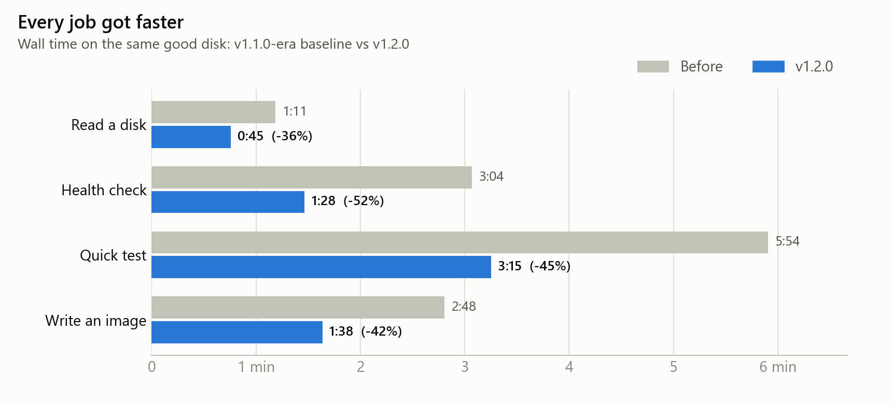
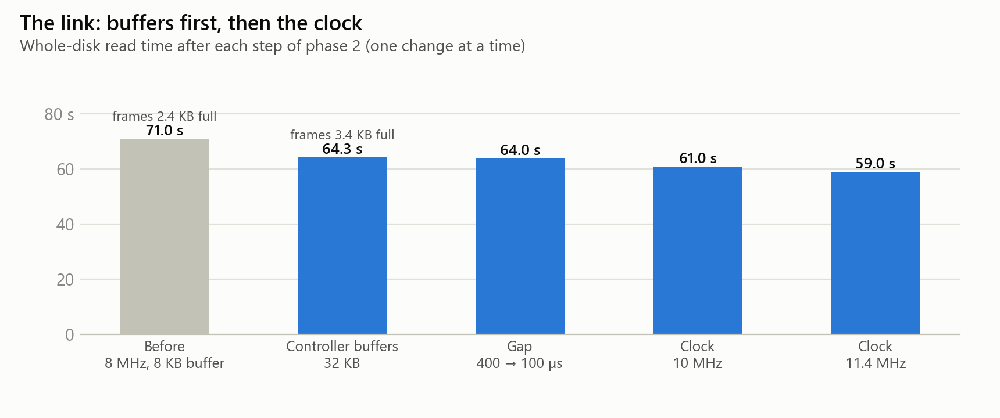
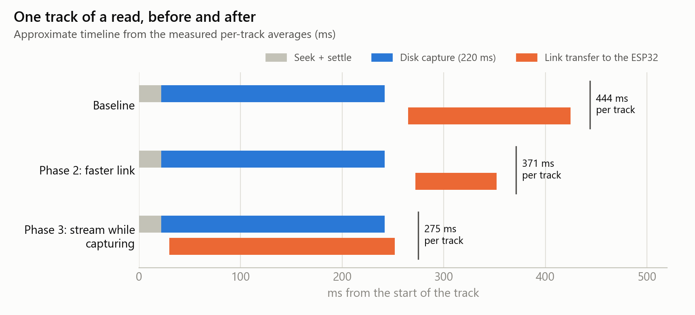
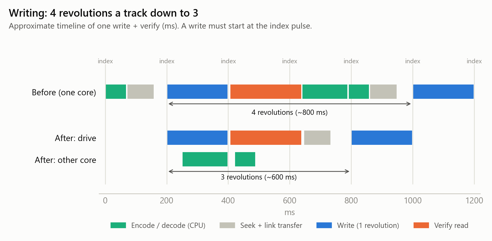
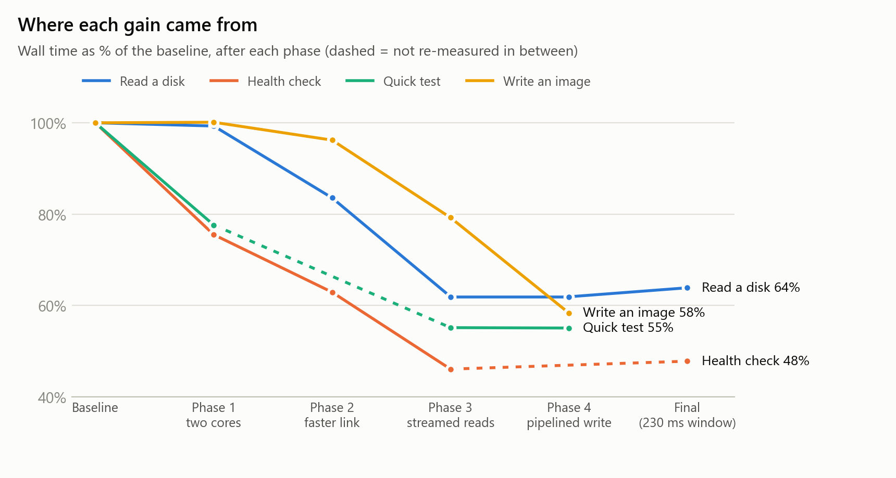

# Making floppy3.5 faster

Firmware v1.2.0 reads a whole disk in **45 seconds instead of 71**, checks a
disk's health in **under half the time**, and writes an image in **1:38 instead
of 2:48**. Nothing about the drive changed. The time went into the firmware's
plumbing, and this is the story of finding it.

<picture>
  <source media="(prefers-color-scheme: dark)" srcset="img/speed-up-summary-dark.png">
  
</picture>

| Job | Before | v1.2.0 | Change |
|---|---|---|---|
| Read a disk | 1:11 | **0:45** | −36% |
| Health check (every track read twice) | 3:04 | **1:28** | −52% |
| Quick test (2 write + read-back passes) | 5:54 | **3:15** | −45% |
| Write an image (write + verify) | 2:48 | **1:38** | −42% |

## How it was measured

One known-good disk, written with a fixed benchmark image: a FAT12 volume
filled to 100% with random files from a fixed seed, so every track carries
data and every read can be checked file by file against a manifest. Every run
of every job was timed and logged, before and after each change, one change
at a time. Repeat runs agree to within about a second, so a gain of a few
percent is real.

Both chips were instrumented as well: the ESP32 counts and times every link
transaction, and the controller times its own interrupt and records why each
link frame left half empty. That turned guesses into numbers more than once.

## Where the time went

A floppy turns at 300 rpm: one revolution every 200 ms. Reading a track means
seeking to it, capturing a little more than one revolution of flux (220 ms,
so a sector that straddles the starting point is caught whole), sending that
~86 KB of flux from the RP2354A controller to the ESP32-S3 over SPI, and
decoding it. Writing a track has to start at the index pulse, lasts exactly
one revolution, and is followed by a verify read.

At the start, everything happened one step after another:

- the ESP32 decoded or encoded a track and then sat idle while the drive
  worked, and the drive sat idle while the ESP32 worked;
- the controller captured the whole track before sending any of it;
- the link ran at 8 MHz, a speed chosen when it was still jumper wires on a
  bench.

## Phase 1: use both ESP32 cores

The ordinary read already decoded on one core while the other read the next
track. The health check and the disk test did not. They now share the same
pipeline: one core drives the disk (write, read back) while the other
compares the last track's read-back and encodes the next one. A track that
fails is rewritten after the pass rather than straight away, with the same
number of retries, so the grading is unchanged.

**Health check −25%, quick test −22%.** Reads did not change: they were
already pipelined.

## Phase 2: the link between the chips

The link should have managed ~0.88 MB/s at 8 MHz. Measured: ~0.5 MB/s. The
instrumentation found why:

- the ESP32 clocked full 4 KB frames, but the frames arrived **only 2.4 KB
  full** on average: 36% of the bits on the wire were padding;
- the controller's send buffer was 8 KB, and the protocol keeps two 4 KB
  frames in flight until they are acknowledged. The buffer was nearly always
  full of frames already sent, so each new frame carried only whatever had
  trickled in since the last acknowledgement.

It was not the gap between frames, and not the processors: the controller's
interrupt took 16 µs on average and 54 µs at worst.

<picture>
  <source media="(prefers-color-scheme: dark)" srcset="img/speed-up-link-dark.png">
  
</picture>

So, one change at a time:

1. **Controller buffers 8/16 KB → 32/32 KB:** frames 3.4 KB full, read 71.0 →
   64.3 s.
2. **Gap between frames 400 → 100 µs:** small, as predicted (64.0 s), but
   free; the interrupt's worst case leaves 2× margin.
3. **Clock 8 → 10 → 11.4 MHz:** 61.0 s, then 59.0 s. The RP2354A's SPI block
   needs its own clock at 12× the link clock, so ~12.5 MHz is the ceiling at
   its standard 150 MHz. The ESP32 can't make 12 MHz exactly from 80 MHz, so
   it runs at 80/7 = 11.43 MHz.

Every step was checked with five whole-disk reads (files compared), a full
write and verify, and zero link errors or retransmits.

**Reads −16%.** Writes barely moved, and that turned out to matter later.

## Phase 3: send a read while the disk is still turning

The controller used to capture a track completely and only then send it. Now
its capture loop hands each newly encoded kilobyte or two to the link as it
goes, so the transfer happens *during* the capture instead of after it.

<picture>
  <source media="(prefers-color-scheme: dark)" srcset="img/speed-up-read-track-dark.png">
  
</picture>

The plan was to move the capture to the RP2354's second core. It turned out
not to be needed: the capture already runs as a polling loop with the link's
interrupt alongside it, so the loop now feeds the link itself. The capture's
sample buffer has ~0.5 ms of slack; across ~1,600 captures it never held more
than 23 of its 512 samples. Reads over USB (the `gw` tool) are left exactly
as they were.

**A drive quirk turned up on the way.** The first track of every read came
back two sectors short. Each job powers the drive up, so the first seek
recalibrates, and after that the drive stays silent for **31 ms** longer than
its normal settle time. The old timing had hidden it by accident. The fix is
100 ms of extra settle after a recalibration only: once per disk.

**Read 59 → 44 s, health check 1:56 → 1:25.** And the writes finally moved:
the quick test went 4:35 → 3:15 and the image write 2:42 → 2:13, because each
track's verify read got shorter.

## Phase 4: the 3-revolution floor

The original plan for writes was to start writing before the whole track had
arrived over the link. On paper it no longer helped: the transfer already
finished ~80 ms before the index pulse, and a write cannot start before the
index. A write + verify needs the write (200 ms), the read-back (~230 ms) and
a step to the next track: ~450 ms of physical work, which can never fit in
two revolutions. **Three revolutions per track is the floor.**

The quick test was already there. The image write was not: it still encoded
each track and decoded its read-back on the same core as the drive, so it
took about four revolutions per track. It now uses the test's two-core
pipeline.

<picture>
  <source media="(prefers-color-scheme: dark)" srcset="img/speed-up-write-revs-dark.png">
  
</picture>

**Image write 2:13 → 1:38.**

## The whole journey

<picture>
  <source media="(prefers-color-scheme: dark)" srcset="img/speed-up-stages-dark.png">
  
</picture>

| Stage | Read | Health check | Quick test | Write an image |
|---|---|---|---|---|
| Baseline | 1:11 | 3:04 | 5:54 | 2:48 |
| Phase 1: both cores | 1:11 | 2:19 | 4:35 | 2:49 |
| Phase 2: faster link | 0:59 | 1:56 | – | 2:42 |
| Phase 3: streamed reads | 0:44 | 1:25 | 3:15 | 2:13 |
| Phase 4: pipelined write | 0:44 | – | 3:15 | 1:38 |
| v1.2.0 (230 ms window) | 0:45 | 1:28 | – | – |

A dash means the job was not re-run at that stage.

**The last change cost a second on purpose.** After phase 3, one marginal
sector on the test disk failed its first read in 2 of 8 runs: the capture now
started at a different point on the rotation, and the weak sector less often
fell in the ~20 ms of overlap where the decoder gets a second copy. Widening
the read window from 220 to 230 ms gave that overlap back. In the next 800
track reads, every one was clean first time, for +1.4 s per disk.

## What was not done, and why

- **Running the ESP32 at 240 MHz on USB power.** After phases 1 and 4 the
  processor is no longer on the critical path of any job: a read's decode
  (~150 ms per track) runs on the other core while the drive and link take
  ~255 ms. It would save ~0.3 s per read, against turning on power management
  and re-testing for brownouts.
- **A link faster than 12.5 MHz** (overclocking the RP2354A, or a PIO-based
  SPI slave). Reads now hide the link behind the capture, and writes are at
  the revolution floor, so the link is not what limits either.
- **Speeding up the reads over USB.** The `gw` tool path is unchanged; it
  could not be retested on the assembled unit.

## What's left

A read is now the 230 ms capture plus a seek, per track, and a write + verify
is three revolutions. Neither gets meaningfully faster without changing what
is measured. Saving a loaded disk to the SD card takes 2 seconds.
